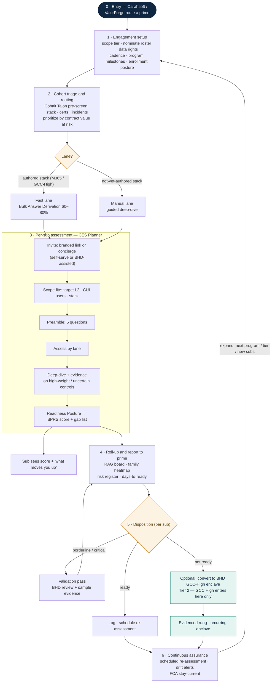

# SCRE Assess-Subs — Engagement Flow

**How an engagement runs, top-down — from the prime deal to the per-sub mechanics.**
**Date:** June 10, 2026 · **Classification:** Internal — strategy
**Companion to:** `BHD-Assess-Subs-Capability.md`, `BHD-Assess-Subs-Build-Spec.md`, `BHD-Planner-as-SCRE.md`.

---

## The flow (top-down)

**0 · Entry (Carahsoft → prime)**
- Carahsoft Sales Desk / ValorForge routes a prime (or mid-tier integrator) with a CUI-heavy, under-certified sub-tier.
- One enterprise sale; the prime is the buyer and the mobilizer.

**1 · Engagement setup (per prime, once)**
- Scope the tier: which programs, which subs; nominate the roster (CAGE/UEI list, or BHD discovers it).
- Set the rules: data rights, sub-consent model, cadence (one-time vs. continuous), and the prime's program milestones (the dates readiness is measured against).
- Pick the enrollment posture: prime mandates / sponsors / endorses / self-pay.

**2 · Cohort triage & routing (per cohort, automated)**
- Zero-touch pre-screen (Cobalt Talon): detect each sub's stack (commercial M365 / GCC High / Google / AWS / on-prem / unknown), cert claims, incident signals.
- Two routing decisions per sub:
  - **Lane** — authored-stack (fast, auto-derive) vs. not-yet-authored-stack (manual deep-dive).
  - **Mode** — self-serve vs. BHD-assisted (concierge).
- Prioritize: assess the highest contract-value-at-risk subs first.

**3 · Per-sub assessment (CES Planner — repeated per sub)**
- Invite: branded link from the prime's program, or scheduled concierge session.
- Scope-lite: target L2, who touches CUI, what stack (drives the CUI-user count).
- Preamble: the 5 questions (license tier, security archetype, endpoint, monitoring, policy state).
- Assess: authored-stack → Bulk Answer Derivation auto-fills 60–80% (accept/override); other stacks → guided deep-dive control-by-control.
- Deep-dive + evidence on the high-weight and uncertain controls.
- Output: a Readiness Posture → SPRS-style score + ranked gap list, tagged by method/confidence.
- Two recipients: the **sub** sees its score and "what moves you up"; **BHD** gets the structured record.

**4 · Roll-up & report (per prime, after each wave)**
- Aggregate every sub's posture into the prime board: RAG by sub, family heatmap (systemic gaps), risk register weighted by contract value, days-to-ready vs. milestones.
- Deliver: live board + PDF for program reviews.

**5 · Disposition (per sub, prime-driven)**
- Ready → log, schedule re-assessment.
- Borderline / critical → optional Validation pass (BHD reviews + samples evidence — higher confidence rung).
- Not ready → optional conversion offer to a BHD GCC-High enclave (Tier 2 — the only point GCC High enters).

**6 · Continuous assurance (recurring — the annuity)**
- Scheduled re-assessment of the tier; drift alerts; the prime keeps a current picture for its FCA "stay-current" affirmations.
- Expansion loops back to Step 1: next program, next tier, newly added subs.

**Spine:** one prime sale → automated triage → Planner per sub → prime roll-up → disposition → continuous re-run. Assessment earns on 100% of the tier on any stack; enclave conversion is optional upside on the subset.

---

## Flow diagram

---

## The two load-bearing choices

- **Lane / Mode routing (Step 2)** — sets cost and effort per sub. The lane depends on whether that stack's vendor playbook has been authored (multi-stack is by design; only M365/GCC-High is built out today — see `BHD-Planner-as-SCRE.md`).
- **Disposition gate (Step 5)** — where the decoupled assessment product and the enclave upside split. GCC High first appears only here, and only for not-ready subs that choose to convert.
