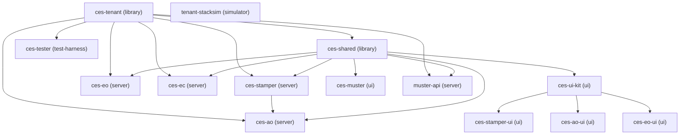

# CES build order (release ces-handoff-2026-11-01-ph13)

> Generated by scripts/handoff/gen.mjs from handoff.manifest.yaml. Do not edit; edit the manifest and rerun gen.

Build the components in this order. Each step runs in the folder shown, relative to the workspace root (the ces-mono clone). A step may start only when every component in its "after" column has built. Build commands chain with `&&`, so run them in `cmd /c` or PowerShell 7, not Windows PowerShell 5.1.

| Step | Component | Kind | Run in | Build command | After |
| --- | --- | --- | --- | --- | --- |
| 1 | ces-tenant | library | `ces-tenant` | `npm ci && npm run build` | (none) |
| 2 | ces-shared | library | `.` | `npm ci && npm run build -w ces-shared` | ces-tenant |
| 3 | ces-stamper | server | `.` | `npm run build -w ces-stamper` | ces-shared, ces-tenant |
| 4 | ces-eo | server | `.` | `npm run build -w ces-eo` | ces-shared, ces-tenant |
| 5 | ces-ao | server | `.` | `npm run build -w ces-ao` | ces-shared, ces-stamper, ces-tenant |
| 6 | ces-ec | server | `.` | `npm run build -w ces-ec` | ces-shared, ces-tenant |
| 7 | ces-ui-kit | ui | `.` | `npm run build -w ces-ui-kit` | ces-shared |
| 8 | ces-stamper-ui | ui | `.` | `npm run build -w ces-stamper-ui` | ces-ui-kit |
| 9 | ces-ao-ui | ui | `.` | `npm run build -w ces-ao-ui` | ces-ui-kit |
| 10 | ces-eo-ui | ui | `.` | `npm run build -w ces-eo-ui` | ces-ui-kit |
| 11 | tenant-stacksim | simulator | `tenant-stacksim` | `npm ci && npm run build` | (none) |
| 12 | ces-tester | test-harness | `ces-tester` | `npm ci && npm run build` | ces-tenant |
| 13 | ces-muster | ui | `ces-muster` | `npm ci && npm run build` | ces-shared |
| 14 | muster-api | server | `ces-muster/muster-api` | `npm ci && npm run build` | ces-shared, ces-tenant |

## Unit tests, same order

| Component | Run in | Test command |
| --- | --- | --- |
| ces-tenant | `ces-tenant` | `npm test` |
| ces-shared | `.` | `npm test -w ces-shared` |
| ces-stamper | `.` | `npm test -w ces-stamper` |
| ces-eo | `.` | `npm test -w ces-eo` |
| ces-ao | `.` | `npm test -w ces-ao` |
| ces-ec | `.` | `npm test -w ces-ec` |
| ces-ui-kit | `.` | `npm test -w ces-ui-kit` |
| ces-stamper-ui | `.` | `npm test -w ces-stamper-ui` |
| ces-ao-ui | `.` | `npm test -w ces-ao-ui` |
| ces-eo-ui | `.` | `npm test -w ces-eo-ui` |
| tenant-stacksim | `tenant-stacksim` | `npm test` |
| ces-tester | `ces-tester` | `npm test` |
| ces-muster | `ces-muster` | `npm test` |
| muster-api | `ces-muster/muster-api` | `npm test` |

## Dependency graph

An arrow points from a component to the components that build after it.

## Legend

- **After**: the components (manifest `deps`) that must build before this one. Some are install-order dependencies: the ces-mono root `npm ci` runs in the ces-shared step, so every other ces-mono component comes after ces-shared.
- **Run in**: the folder, relative to the workspace root, where the command runs (manifest `cwd`, else the repo folder).
- **workspace root**: the ces-mono clone; the other repos sit in folders inside it.
